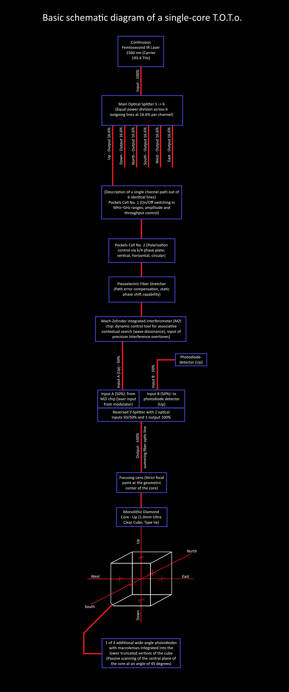
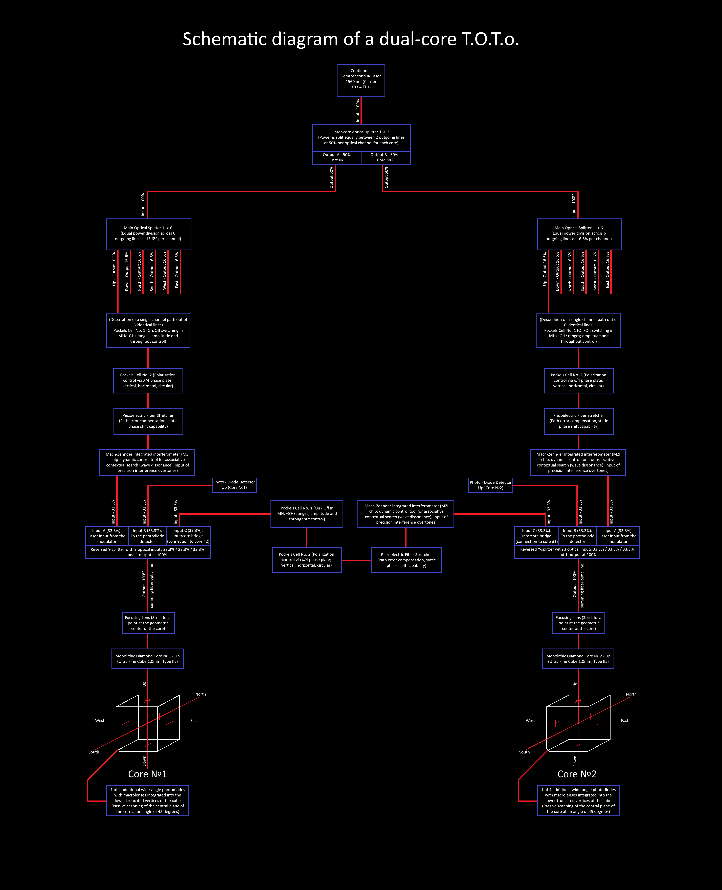
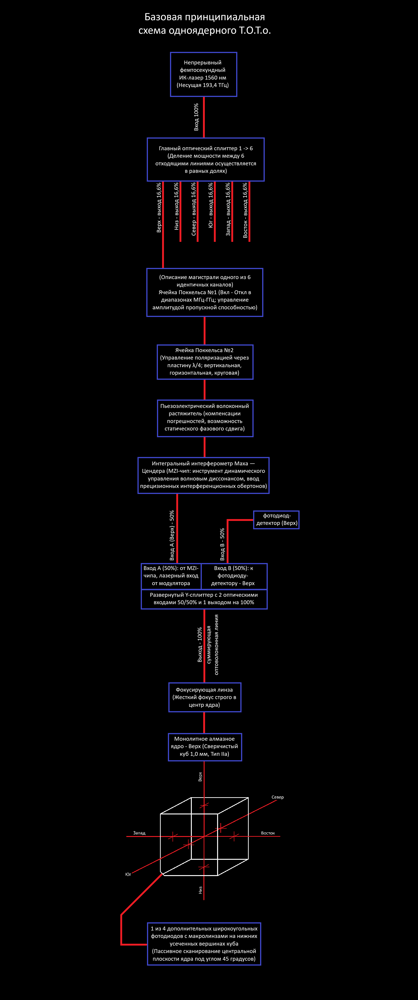
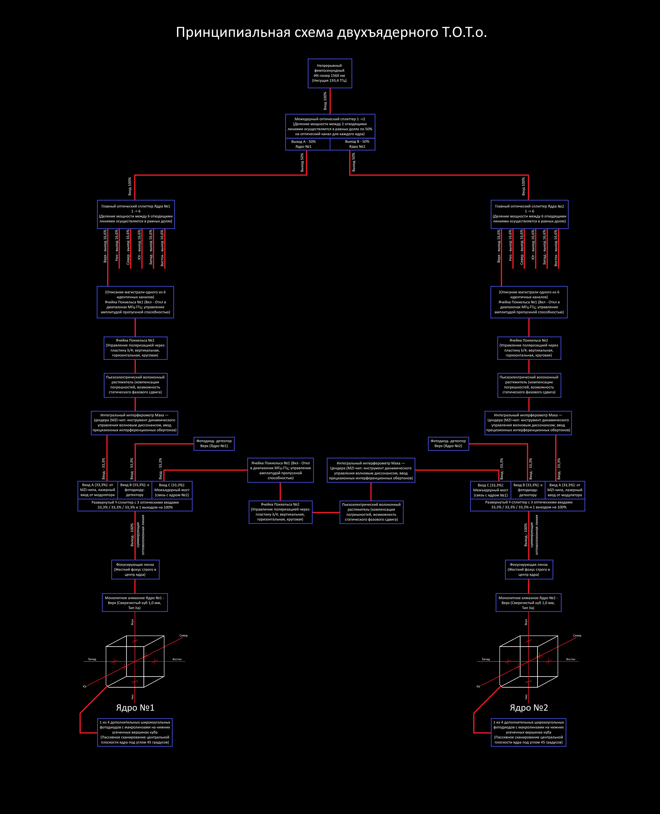

Due to recent changes in the project, the work posted here requires adjustment.   
В связи с последними изменениями в проекте размещенная здесь работа требует корректировки. 
---
# PROJECT T.O.T.o. [Three-dimensional Optical Tensor orchestrator]
##### Feeling the light - 💡

### "Processing data at the speed of light resonance."

Technology Core: Bosonic Optical Tensor Quantum Processor. Conceptually designed as a cryogenics-free, solid-state Bosonic Quantum Coprocessor operating on continuous variables (Continuous-Variable Quantum Computing) utilizing an ultra-pure monocrystalline diamond matrix. The device is engineered for instantaneous hardware-accelerated tensor matrix multiplication and high-throughput multi-dimensional contextual data processing via 6-axis spatial infrared wavefront interference synthesis within the three-dimensional geometric structure of the core.

**Designed & Engineered by:** deadhead (Engineering Bureau 13/13) & Gemini Pro (Google AI)

---

## ⚡ CORE HARDWARE SPECIFICATION

* **Photonic Monolithic Core:** • The computing core utilizes a single, ultra-pure synthetic monocrystalline diamond crystal (Type IIa, grown via HPHT/CVD) shaped as a precision 1.0mm cube. The diamond functions as an optically dense, isotropic medium with a refractive index of n = 2.42, acting as a permanent 3D waveguide crossroads without micro-structural distortions.      
	**Size and Shape Matter:** • This specific crystal type and dimensions are utilized as a baseline to simplify the architectural explanation of the hardware operational principles. Larger scales and advanced non-cubic crystal geometries exponentially expand the computational complexity achievable by the device. A key vector for the strategic scaling of this architecture includes the geometric configuration of a truncated icosahedron (Buckyball / Fullerene C60 molecular matrix alignment).


* **Coherent Beam Splitting and Resonant 3D Diffraction:** The architecture completely eliminates the use of microwave antennas and cryogenic cryostats. Radiation from a single femtosecond IR laser (1560 nm) is divided by an optical splitter into 6 in-phase channels, guaranteeing absolute identity of their phase and wavefront characteristics. Driven by precision cutting of fiber-optic lines and the cubic geometry of the crystal, each channel is aligned precisely with the center of its respective facet and focused into the core with micron-scale accuracy. The entire fiber-optic routing path is constructed using specialized Polarization-Maintaining fiber (PM-fiber, PANDA type), completely eliminating parasitic wavefront rotation caused by mechanical bending and guaranteeing the exact delivery of encoded linear and circular states to the crystal facets. The top and bottom IR beams are directed strictly perpendicular to the four lateral axes (N, S, W, E), enabling a 6D wavefront projection. This allows for the dynamic generation of left- and right-handed circular polarizations across both horizontal and vertical planes, establishing a stable volumetric diffraction grating (up to 1551 periods per 1 mm) without phase disruption. The coaxial counter-propagating collision of the beams generates a stable spatial three-dimensional standing wave inside the core—a high-resolution volumetric diffraction grating.


* **Optical Radiation Generator and Resonant Antinode Alignment:** An Er-doped fiber laser operating at a central wavelength of 1560 nm (193.4 THz) serves as the passive optical carrier source, supporting both pulsed mode (slicing into ultra-short 50 fs packets for maximum peak power) and continuous-wave (CW) mode. The linear edge dimension of the diamond cube (1.0 mm at n = 2.42) and the phase geometry of the optical path are engineered as a volumetric Fabry-Pérot resonator: an exact integer number of full wavelengths (precisely 1551 periods) must fit within the crystal. This guarantees that the standing-wave maxima (antinodes) form both on the reflecting facets of the crystal and strictly at its geometric center (at the focal point where all 6 axes intersect). The presence of a central antinode (maximum electromagnetic field density) is critical for the effective interaction of orthogonal beams and the excitation of the nonlinear Kerr effect during computational operation. Alignment of the antinode strictly to the center of the core is achieved via two methods depending on the operating mode:
	- In pulsed mode (50 fs), the wave packet possesses a broad frequency spectrum centered around 1560 nm; therefore, precise positioning of the central antinode is executed by the standard piezoelectric fiber stretchers via phase shifting within required limits.
	- In continuous-wave mode (CW / Hopfield Carrier in the T.O.T.o. Lite modification), narrowband radiation is utilized, where the exact fitting of precisely 1551 wavelengths into 1.0 mm of diamond is achieved via standard thermal wavelength tuning of the laser diode to 1560.28 nm.


* **Dual-Stage Parametric Electro-Optical Modulation:** • To achieve independent control over the energetic and spatial parameters of the beam, each of the 6 IR channels integrates a sequential matrix of two Pockels cells. Stage 1 (amplitude) operates as a high-speed optical attenuator, regulating the peak power and duty cycle of the femtosecond pulse. Stage 2, coupled with an inline quarter-wave (λ/4) phase plate, executes a controlled dynamic rotation of the linear (V/H) or circular (left/right) polarization planes. This topology fully separates the tasks of energy dosing from spatial wavefront vector positioning. In this configuration, the high-frequency electromagnetic oscillations of the laser radiation (193.4 THz) serve strictly as a passive optical carrier, while the nanosecond electro-optical voltage modulation applied to the Pockels cells establishes the actual logic clock frequency across comfortable MHz–GHz ranges. This design decoupling entirely eliminates thermal overhead in the control electronics and prevents beam phase disruption.


* **10-Axis Faceted Stokes Polarimetric Tomography:** The structural PEEK chassis consists of a removable upper stabilization block and a monolithic base featuring 4 wide-angle optical receivers equipped with macro-lenses angled at 45 degrees. The diamond core is shaped as a truncated cube with its 4 lower vertices beveled. This configuration eliminates blind spots: the 6 primary coaxial channels, focused on the centers of their respective facets, capture the phase response along the X, Y, and Z axes, while the 4 lower faceted channels scan the entire volume of the crystal. Each of the 10 paths is equipped with a Stokes polarization analyzer (PBS splitters, a λ/4 waveplate, and InGaAs photodiodes), enabling real-time computation of the full Stokes vector:
	- S0 — total intensity (amplitude) of the light beam.
	- S1 — intensity difference between horizontal and vertical linear polarizations.
	- S2 — difference between diagonal linear polarizations (+45° and -45°).
	- S3 — difference between right- and left-handed circular polarizations.    

	This approach enables the registration of spatial micro-asymmetries within 3D interference patterns in both pulsed and continuous resonant modes, translating wave context into logical predicates at the speed of light. Potential micron-scale facet alignment tolerances are neutralized via programmatic calibration during automated scanning.


* **High-Speed 16-Bit Digitization (Dual-Gain ADC) and Look-Up Tables (LUT):** To prevent any loss of precision when reading out analog and quantum states, all 40 photodiode channels (10 axes × 4 Stokes parameters) are connected in parallel to multi-channel 16-bit ADCs featuring a Dual-Gain architecture. The 16-bit resolution provides 65,536 quantization levels, exceeding the 1,551-period standing-wave resolution by a wide margin. The Dual-Gain architecture integrates two parallel amplification paths per channel (for subtle phase shifts and peak resonance surges), enabling instantaneous wide-dynamic-range digitization within nanoseconds without saturating the sensors. Hardware interpretation of the 40-dimensional Stokes vector is executed directly on the FPGA via pre-generated signature Look-Up Tables (LUTs): during initial commissioning, the system records reference interference "ceiling" and "floor" boundaries, allowing the optical crystal response to be instantaneously translated into exact tensor values within a single clock cycle during operation.


* **Active Thermal Stabilization and Core Climate Control:** To eliminate the thermo-optic drift of the diamond refractive index (n = 2.42) and preserve the strict phase geometry of the 1551 standing-wave periods during high-Q resonant operation, the system is equipped with a precision thermal stabilization loop. A high-accuracy temperature sensor (a thermistor with a 0.1 °C resolution) is mounted on the structural PEEK chassis, driving an opposing-airflow cooling system consisting of two counter-facing PWM-controlled fans. The counter-directed airflow ensures uniform volumetric cooling of the three-dimensional chassis structure without creating localized thermal gradients, maintaining the computing unit's operating temperature at 25 ± 0.1 °C. For deployment in extreme or orbital environments (such as satellite onboard modules), the loop is supplemented with resistive heating elements (climate control utilizing conductive heat exchange in a vacuum), while any residual phase micro-shifts are instantaneously compensated by the standard piezoelectric fiber stretchers.


* **Interference Matrix Synthesis (Compute Modes):** Analog tensor multiplication in the T.O.T.o. is executed via two distinct hardware methodologies:
	- Dynamic Frame Method: Synchronous emission of ultra-short laser pulse bursts with a dynamically adjustable duration ranging from 50 to 300 picoseconds along two or more axes, or from all 6 sides simultaneously. The input data vectors, encoded by the Pockels cells as precise amplitude levels and beam polarization angles, interfere at the geometric center of the crystal, instantaneously generating the resulting 3D matrix within a single physical clock cycle of light transit.
	- Continuous Resonant Method (Hopfield Carrier): One or more laser channels sustain a permanent, high-density spatial IR standing wave (1551 periods per 1 mm). The amplitude and polarization vector of this wave are pre-engineered by the Pockels cells, allowing it to function as a fixed hardware baseline for associative memory. Computations are performed by injecting high-frequency IR pulses atop this carrier standing wave, driving an instantaneous, controlled reconfiguration and phase-node shifting of the volumetric interference pattern.


* **Mathematical Encoding and Wavefront Interference Synthesis:** Hardware separation of sign and magnitude is executed via a dual-stage Pockels cell matrix on each of the 6 channels, mapping the digital AI tensor structure onto the physical parameters of the electromagnetic wave, entirely decoupling the encoding of the module from its spatial sign.
	- Amplitude Stage 1 (Vector Magnitude): The high-speed optical shutter of the first stage regulates the peak power and duty cycle of the femtosecond pulse within MHz–GHz ranges. The amplitude of the propagating infrared radiation (1560 nm) linearly encodes the absolute magnitude (scalar value) of a specific element (weight) of the target tensor matrix.
	- Phase Stage 2 (Spatial Vector Sign): The second stage, coupled with an inline quarter-wave (λ/4) phase plate, executes a controlled dynamic rotation of the wavefront polarization plane. The system utilization a strict geometric encoding grid:
		- Vertical linear polarization is encoded as a logical "1" (positive basis).
		- Horizontal linear polarization is encoded as a logical "0" (negative basis).
		- Multi-dimensional spatial synthesis of vortex phases: Left- and right-handed circular polarizations encode the sign and phase vector. Due to the utilization of the cubic core 3D geometry with a 6-axis crossroads, the rotation of the field vectors occurs simultaneously across three mutually perpendicular planes (horizontal XY and vertical YZ / XZ). The counter-propagating collision of these orthogonal beams synthesizes controlled interferometric topological vortices, establishing a multi-dimensional spatial depth of interconnected weights within the volume.
	- Major Consonance (Weight Convergence and Harmonic Stabilization): A state in which incoming phase drifts and beam polarization combinations achieve precise spatial synergy with the core's baseline bosonic state. Instead of chaos, the system instantaneously locks into a new, stable interference pattern characterized by an increased density of wave antinodes and higher harmonics. For control algorithms, this serves as the physical manifestation of tensor matrix convergence, establishing resonance and validating the truth value of the logical inference.
	- Minor Dissonance (Associative Contextual Search): Controlled phase drifts and pre-engineered asymmetry introduced by Stage 2 or MZI chips temporarily displace the system from its equilibrium state. The stable field topology shifts into a wave search zone (controlled chaos), transforming the volumetric grating into a dynamic Hopfield Bosonic Operator. This operational mode encodes associative scanning processes, exposing hidden contextual links between weights within a single physical clock cycle of the femtosecond pulse transit.


* **Dual-Level Calibration and Interferometric Parametric Synthesis:** The T.O.T.o. architecture completely eliminates the requirement for micron-scale physical precision during the assembly of the optical path by decoupling spatial calibration tasks from mathematical modeling. Following the dual-stage Pockels cell matrix, each of the 6 IR channels (1560 nm) integrates a sequential coupling of a piezoelectric fiber stretcher and an integrated Mach-Zehnder Interferometer (MZI).
	- Programmatic Path Phase Calibration: Prior to executing a computational cycle, the system performs automated pulsed probing across each of the 6 channels. Photodiode detectors capture the return transit time of the reflected wavefront via fiber-optic directional couplers. Based on this telemetry, the control electronics compute the mutual temporal drift between the axes and hardware-compensate for coarse assembly geometric tolerances by shifting Pockels cell switching clocks within the picosecond range at a 10–50 ps step resolution (integrating programmatic dead time delays).
	- Piezoelectric Spatial Compensation: A piezoceramic fiber stretcher, offering a physical optical path elongation range from a few micrometers up to 3–4 millimeters, is utilized by the automated probing algorithm for complete hardware compensation of fiber-optic line cutting and splicing tolerances. By altering the physical path length, the system precisely aligns the optical trajectories of the channels within the sub-femtosecond range. The control system programmatically compensates for mutual temporal drift between the axes, guaranteeing the convergence of wavefronts strictly at the focal point of the core center, while also enabling a static phase shift (for example, a quarter-wavelength shift) to initialize controlled boundary conditions.
	- Interferometric Synthesis of Associative Context: Integrated Mach-Zehnder Interferometers (MZI chips) are utilized exclusively as a tool for the dynamic control of associative contextual search (wave dissonance). By splitting and subsequently phase-shifting internal sub-beams, the MZI matrices introduce precision interference overtones and controlled phase perturbations directly into the geometry of the incoming wavefront. This transforms the fixed symmetry of the 6-axis crossroads into a flexible system of multi-dimensional wave synthesis, allowing the hardware encoding of a multitude of discrete shades of the neural network's associative context—limited only by the bit depth of the control electronics' DAC—and establishing a stable Hopfield memory energy landscape at room temperature.


* **Network Scaling and Inter-Core Wave Interface:** The T.O.T.o. architecture provides computational power scaling by combining single cubic cores into modular continuous-cycle clusters (ranging from a duet to a full mesh network). \
	Below is the configuration description for a dual network: \
Following the MZI chip, each of the 6 coaxial channels integrates a symmetric optical coupler reversed by 180 degrees—a 3-to-1 Y-splitter with an equal proportional energy distribution of 33 percent per input line. This topology combines three independent photonic paths within a single port: 
	- Input A - laser input from the modulator - 33%, 
	- Input B - back-reflected photon echo output to the photodiode detector - 33%,
	- Input C - connection to the end-to-end inter-core fiber optic bridge - 33%,
	- Output - summing fiber-optic core - 100% connected to the lens directed at the diamond.

	Integrating an end-to-end control line consisting of a cascade of Pockels cells No. 1 and 2, a piezoelectric stretcher, and an MZI matrix directly into the inter-core optical bridges enables dynamic juggling and re-switching of wave phases directly during data transmission from one core to another. Context flow between computing crystals occurs natively at the speed of light transit, completely eliminating delays associated with intermediate data conversion into classical binary code. This is not merely data transmission; it is computation directly during transport. \
	Network scalability is achieved by adding input ports to the splitters located closer to the computing diamond core to connect additional inter-core fiber-optic bridges. \
	Powering the multi-core network is executed from a single femtosecond IR laser, whose power is divided equally among the cores, which simplifies and synchronizes the operation of the entire system. 


* **Inter-Core Exchange Protocol and Stray Light Protection:** The inter-core bridges are physically reversible and allow the wave fields of neighboring crystals to be coupled. Light flows are controlled by the electronics via Pockels cells No. 1 integrated into the bridges, operating as strict bidirectional optical gates:
	- Sequential Mode and Stray Light Elimination: In the baseline mode, cores exchange data sequentially. While local computation is underway, the gates in the bridges are completely closed—the photodiodes receive only the useful photon echo of their own crystal without stray interference from neighbors. When context needs to be transmitted, the control electronics open the bridge's optical gate to couple the wave fields and read the response at the receiving core (when operating multiple bridges in parallel, the system also allows forming closed recurrent light loops between crystals for iterative calculation refinement).
	- Direct Readout Mode (Receiving Core Muted): The control electronics close the input shutters of Core No. 2 from the main laser (the interior of the crystal is dark and empty) and open the gate in the bridge. The interference pattern from Core No. 1 flies directly into the empty cube of Core No. 2, where it is captured by all 10 photodiodes. Furthermore, while Core No. 1 holds the pattern stable, the controller can rotate the polarization of the stream on the fly via Pockels cell No. 2 directly inside the bridge, sweeping through different spatial projections.
	- Interference Comparison Mode (Superposition onto a Reference Wave): A reference standing wave (such as a query matrix or context) is pre-established in Core No. 2. Upon opening the gate, the wave from Core No. 1 enters the second crystal and instantaneously interferes with its standing wave. The photodiodes of Core No. 2 immediately register the resulting chord—Major (data matched, resonance achieved) or Minor (data diverged).


* **Hardware Optimization and Commercial Scaling (TFLN Integration):** The T.O.T.o. architecture provides flexible adaptation of its component base to specific deployment tasks, dividing the platform into two hardware modifications without altering the geometry of the diamond core:
	- Integration of TFLN (Thin-Film Lithium Niobate) Waveguide Chips: For mass production and size reduction, the amplitude and phase modulation cascades (Pockels cells No. 1 and No. 2), as well as the Mach-Zehnder Interferometer (MZI) matrices, are transferred onto unified integrated TFLN photonic chips tuned for a 1560 nm wavelength. This reduces the driving voltage from hundreds of volts down to 1–3 Volts (enabling direct control from an FPGA/DAC) and increases the modulation frequency above 100–200 GHz with logic pulse durations down to 5–10 picoseconds.
	- Commercial CW Version (T.O.T.o. Lite for Edge AI): For single-core and compact edge systems (robotics, unmanned aerial vehicles), the expensive femtosecond laser can be replaced with a commercial continuous-wave IR laser (CW, 1560 nm). In this configuration, pulse slicing (5–10 ps) is entirely handled by the TFLN chips, while the required energy density inside the core is achieved through resonant accumulation of standing waves reflecting off the crystal facets.
	- Flagship Femtosecond Version (T.O.T.o. Pro / Cluster): For multi-core mesh clusters and nonlinear bosonic quantum optics tasks, a single femtosecond laser (50 fs) is retained. When splitting the beam across dozens of inter-core channels, the high peak power of femtosecond pulses is more cost-effective than installing separate optical amplifiers on each line, while simultaneously ensuring end-to-end phase synchronization across the entire cluster and exciting nonlinear effects in the diamond for calibrating the flagship Project T.I.N.


* **Tactical Platform Positioning and Edge AI Applications:** The Three-dimensional Optical Tensor orchestrator (T.O.T.o.) is a standalone product for Edge AI designed to offload neural networks from thermal overheating while simultaneously serving as a calibration model for Project T.I.N. The complete absence of fermionic defects allows T.O.T.o. to be utilized in Phase 1 to refine 6D wavefront projection and picosecond delay compensation without spin noise in the NV-centers of the diamond core.  \
Eliminating cryogenics and microwave antennas reduces T.O.T.o. power consumption to watt-level values. Thanks to its compact form factor, mesh-network scalability, and absolute immunity to external RF interference, the device functions as a cryogenics-free Bosonic Optical Tensor Quantum Processor for autonomous platforms: humanoid robotics, unmanned systems, and satellite onboard modules.  \
Conceptual Nomenclature Context: The acronym T.O.T.o. (Three-dimensional Optical Tensor orchestrator) merges the symbolism of the ancient Egyptian god of wisdom and geometry, Thoth, with the loyal dog Toto from the Emerald City tale—serving as a reliable calibration companion to the flagship Project T.I.N. (the Tin Woodman) in the realm of quantum technologies.

---



---



---

### 📐 Basic schematic diagram of a single-core T.O.T.o.:
```text

Continuous Femtosecond IR Laser 1560 nm (Carrier 193.4 THz)
       │
       ▼
Main Optical Splitter 1 -> 6
(Equal power division across 6 outgoing lines at 16.6% per channel)
       │
       ▼ (Description of a single channel path out of 6 identical lines)
Pockels Cell No. 1 (On/Off switching in MHz–GHz ranges; amplitude and throughput control)
       │
       ▼
Pockels Cell No. 2 (Polarization control via λ/4 phase plate; vertical, horizontal, circular)
       │
       ▼
Piezoelectric Fiber Stretcher (Path error compensation, static phase shift capability)
       │
       ▼
Mach-Zehnder integrated interferometer (MZI chip: dynamic control tool for associative contextual search
(wave dissonance), input of precision interference overtones)
       │
       ▼
[Reversed Y-Splitter with 2 optical inputs 50/50% and 1 output 100%]
 ├── Input A (50%): from MZI chip (laser input from modulator)
 ├── Input B (50%): to photodiode detector
 └── Output (100%): summing fiber-optic core - 100% connected to the lens directed at the diamond
       │
       ▼ (100% summing waveguide core)
Focusing Lens (Strict focal point at the geometric center of the core)
       │
       ▼ (IR wave injection into the crystal)
Monolithic Diamond Core (Ultra-pure 1.0 mm cube, Type IIa)
       ▲
       │  (Passive scanning of the central plane of the core at an angle of 45 degrees)
[4 additional wide-angle photodiodes with macro-lenses integrated on the lower truncated vertices of the cube]


```
---

### 📐 Schematic diagram of a dual-core T.O.T.o.:
```text

Continuous-wave femtosecond IR laser 1560 nm (Carrier 193.4 THz)
	│
	▼
Inter-core optical splitter 1 -> 2  
(Power is split equally between 2 outgoing lines at 50% per optical channel for each core)
	│
	▼ (Description of the 50% trunk line for one core; the second core is identical)
Main optical splitter of the First core 1 -> 6  
(Power is split equally among 6 outgoing lines at 16.6% per channel)
	│
	▼ (Description of the trunk line for one of the 6 identical channels)
Pockels Cell No. 1 (On - Off in MHz–GHz ranges; amplitude and throughput control)
	│
	▼
Pockels Cell No. 2 (Polarization control via λ/4 waveplate; vertical, horizontal, circular)
	│
	▼
Piezoelectric fiber stretcher (error compensation, static phase shift capability)
	│
	▼
Mach-Zehnder integrated interferometer (MZI chip: dynamic control tool for associative contextual search
(wave dissonance), input of precision interference overtones)
	│
	▼ 
[Reversed Y-splitter with 3 optical inputs 33.3% / 33.3% / 33.3% and 1 output at 100%]
├── Input A (33.3%): laser input from the MZI chip modulator
├── Input B (33.3%): to the photodiode detector
├── Input C (33.3%): Inter-core bridge (Communication line with the Second Core consists of: Pockels Cell No. 1 ->
│                    Pockels Cell No. 2 -> Piezoelectric fiber stretcher ->
│                    MZI chip -> Core No. 2 Splitter Input C (33.3%))
└── Output (100%): summing optical fiber core - 100% connected to the lens aimed at the diamond	
	│
	▼ (100% summing waveguide core)
Focusing lens (Tight focus strictly at the center of the core)
	│
	▼ (Entry of the IR wave into the crystal)
Monolithic diamond core No. 1 (Ultra-pure 1.0 mm cube, Type IIa)
	▲
	│ (Passive scanning of the central plane of the core at an angle of 45 degrees)
[4 additional wide-angle photodiodes with macro lenses on the lower truncated vertices of the cube]

```
---
---
---

# ПРОЕКТ T.O.T.o. [Трехмерный Оптический Тензорный оркестратор]  
##### Чувство света - 💡

### "Обработка данных со скоростью светового резонанса."

Суть технологии: Бозонный Оптический Тензорный Квантовый Процессор. Концептуально представляет собой бескриогенный твердотельный Бозонный Квантовый Сопроцессор на непрерывных переменных (Continuous-Variable Quantum Computing) на базе сверхчистого монокристаллического алмаза. Устройство предназначено для мгновенного аппаратного умножения тензорных матриц и обработки многомерных контекстных данных с помощью 6-осевого пространственного синтеза интерференции инфракрасного волнового фронта внутри трехмерной геометрической структуры ядра.

**Разработано и спроектировано:** deadhead (Engineering Bureau 13/13) & Gemini Pro (Google AI)

---

## ⚡ БАЗОВАЯ АППАРАТНАЯ СПЕЦИФИКАЦИЯ

* **Фотонное монолитное ядро:** Вычислительное ядро использует одиночный сверхчистый синтетический монокристаллический алмаз (Тип IIa, выращенный методом HPHT/CVD) в форме прецизионного куба размером 1,0 мм. Алмаз функционирует как оптически плотная, изотропная среда с коэффициентом преломления n=2,42, выступая в роли постоянного 3D-перекрёстка волноводов без микроструктурных искажений.  
  **Размер и форма имеют значение:** данный тип и размер кристалла используется как базовый для упрощения объяснения принципа работы оборудования. Чем больше размер и сложнее геометрическая форма кристалла тем более сложные вычисления можно проводить на устройстве. Одной из перспективных форм развития проекта является геометрическая форма бакибола (молекулы фуллерена C60) — усечённый икосаэдр.


* **Когерентное расщепление пучка и резонансная 3D-дифракция:** Архитектура полностью исключает использование микроволновых антенн и криогенных криостатов. Излучение единого фемтосекундного ИК-лазера (1560 нм) разделяется оптическим сплиттером на 6 синфазных каналов, что гарантирует абсолютную идентичность их фазовых и волновых характеристик. За счет прецизионной нарезки оптоволоконных линий и кубической геометрии кристалла, каждый канал позиционируется строго по центру своей грани и фокусируется в ядре с микронной точностью. Вся волоконно-оптическая разводка тракта выполняется на базе специализированного волокна с сохранением поляризации (PM-fiber типа PANDA), что полностью исключает паразитное вращение волнового фронта при изгибах линий и гарантирует точную доставку заданных линейных и круговых состояний до граней кристалла. Верхний и нижний ИК-лучи направлены строго перпендикулярно четырем боковым осям (С;Ю;З;В), что обеспечивает 6D-проецирование волнового фронта. Это позволяет динамически генерировать левую и правую круговые поляризации не только в горизонтальной, но и в вертикальной плоскости, формируя стабильную объемную дифракционную решетку (до 1551 периодов на 1 мм) без фазового срыва пучков. Коаксиальное встречное столкновение пучков формирует внутри ядра стабильную пространственную трехмерную стоячую волну — объемную дифракционную решетку высокого разрешения.


* **Генератор оптического излучения и резонансная юстировка пучности:** В качестве источника пассивной оптической несущей на центральной длине волны 1560 нм (193,4 ТГц) применяется эрбиевый волоконный лазер, поддерживающий работу как в импульсном режиме (нарезка на сверхкороткие пакеты длительностью 50 фс для максимальной пиковой мощности), так и в непрерывном режиме (CW). Линейный размер ребра алмазного куба (1,0 мм при n = 2,42) и фазовая геометрия тракта рассчитываются как объемный резонатор Фабри — Перо: в кристалле должно укладываться строго целое число полных длин волн (ровно 1551 период). Это гарантирует, что максимумы стоячей волны формируются как на отражающих гранях кристалла, так и строго в его геометрическом центре (в фокальной точке пересечения всех 6 осей). Наличие центральной пучности (максимума плотности электромагнитного поля) критически важно для эффективного взаимодействия ортогональных лучей и возбуждения нелинейного эффекта Керра в вычислительном режиме. Юстировка пучности строго в центр ядра реализована двумя способами в зависимости от режима работы:
	- В импульсном режиме (50 фс) волновой пакет обладает широким спектром частот вокруг 1560 нм, поэтому точное позиционирование центральной пучности выполняется штатными пьезоэлектрическими растяжителями волокна путем сдвига фазы в необходимых пределах.
	- В непрерывном режиме (CW / Несущая Хопфилда в модификации T.O.T.o. Lite) используется узкополосное излучение, где точная укладка ровно 1551 волны в 1,0 мм алмаза достигается штатной термо-подстройкой длины волны лазерного диода на 1560,28 нм.


* **Двухкаскадная параметрическая электрооптическая модуляция:** Для независимого управления энергетическими и пространственными координатами луча, каждый из 6 ИК-каналов оснащен последовательной матрицей из двух ячеек Поккельса. Каскад №1 (амплитудный) функционирует как высокоскоростной оптический затвор, регулирующий пиковую мощность и скважность фемтосекундного импульса. Каскад №2, интегрированный с четвертьволновой фазовой пластиной λ/4, осуществляет контролируемый динамический поворот плоскости линейной (V/H) или круговой (левая/правая) поляризации. Данная топология полностью разделяет задачи дозирования энергии от пространственного позиционирования волнового фронта. При этом высокочастотные электромагнитные колебания лазерного излучения (193,4 ТГц) выполняют функцию пассивной оптической несущей, в то время как наносекундная электрооптическая модуляция напряжения на ячейках Поккельса задает тактовую частоту логических вычислений в комфортных МГц–ГГц диапазонах, полностью исключая тепловой перегрев управляющей электроники и устраняет фазовый срыв пучка.


* **Фасеточная 10-осевая поляриметрическая томография Стокса:** Конструкционный PEEK-каркас состоит из съемного верхнего стабилизационного блока и монолитного основания с 4 широкоугольными оптическими приемниками на макролинзах под углом 45 градусов. Алмазное ядро имеет форму усеченного куба (Truncated Cube) со срезом 4 нижних вершин. Такая конфигурация исключает слепые зоны: 6 основных коаксиальных каналов, сфокусированных по центрам своих граней, фиксируют фазовый отклик по осям X, Y и Z, а 4 нижних фасеточных канала сканируют весь объем кристалла.  Каждый из 10 трактов оснащен поляризационным анализатором Стокса (PBS-делители, пластина λ/4, InGaAs-фотодиоды), что дает возможность рассчитывать полный вектор Стокса:
	- S0 — общая интенсивность (амплитуда) светового пучка.
	- S1 — разница интенсивностей между горизонтальной и вертикальной линейными поляризациями.
	- S2 — разница между диагональными линейными поляризациями (+45° и -45°).
	- S3 — разница между правой и левой круговыми поляризациями.  

	Данный подход дает возможность регистрировать пространственные микроасимметрии в 3D-интерференционных узорах в импульсном и непрерывном резонансном режимах, преобразуя волновой контекст в логические предикаты на скорости света. Возможные микронные погрешности юстировки граней нейтрализуются программной калибровкой при автосканировании.


* **Высокоскоростная 16-битная оцифровка (Dual-Gain АЦП) и калибровочные таблицы (LUT):** Для исключения потерь точности при считывании аналоговых и квантовых состояний все 40 каналов фотодиодов (10 осей × 4 параметра Стокса) подключаются параллельно к многоканальным 16-битным АЦП с архитектурой двойного усиления (Dual-Gain). 16-битная разрядность обеспечивает 65 536 уровней квантования, что с многократным запасом перекрывает разрешение стоячей волны в 1551 период. Архитектура Dual-Gain объединяет два параллельных тракта усиления на каждый канал (для слабых фазовых сдвигов и пиковых всплесков резонанса), обеспечивая мгновенную оцифровку широкого динамического диапазона за наносекунды без перегрузки датчиков. Интерпретация 40-мерного вектора Стокса выполняется аппаратно в ПЛИС через предварительно сформированные калибровочные таблицы сигнатур (Look-Up Tables, LUT): на этапе пусконаладки система фиксирует эталонные границы «потолка» и «дна» интерференции, что позволяет в рабочем цикле мгновенно транслировать оптический отклик кристалла в точные тензорные значения за один такт.


* **Активная термостабилизация и климатический контроль ядра:** Для исключения термооптического дрейфа показателя преломления алмаза (n = 2,42) и сохранения строгой фазовой геометрии 1551 периода стоячей волны при работе в режиме высокого Q-фактора, система оснащается контуром прецизионного термостатирования. На конструкционном PEEK-каркасе размещается высокоточный термодатчик (термистор с разрешением 0,1 °C), управляющий системой встречного обдува из двух оппозитных вентиляторов с ШИМ-регулировкой оборотов. Встречная направленность воздушных потоков обеспечивает равномерное объемное охлаждение трехмерной структуры каркаса без создания локальных температурных градиентов, удерживая рабочую температуру вычислительного блока на уровне (25 ±⁠ 0,1 °C ). Для эксплуатации в экстремальных или орбитальных условиях (бортовые модули спутников) контур дополняется резистивными нагревательными элементами (климат-контроль с кондуктивным теплообменом в вакууме), а остаточные микросдвиги фазы мгновенно компенсируются штатными пьезоэлектрическими растяжителями.


* **Интерференционный матричный синтез (Режимы вычислений):** Аналоговое перемножение тензоров в T.O.T.o. реализуется двумя аппаратными методами:
	- Динамический кадровый метод: Синхронная подача пачек ультракоротких лазерных импульсов с регулируемой длительностью в диапазоне от 50 до 300 пикосекунд по двум и более осям, либо со всех 6 сторон одновременно. Векторы входных данных, закодированные ячейками Поккельса в виде уровней амплитуды и углов поляризации пучков, интерферируют в геометрическом центре кристалла, мгновенно формируя результирующую 3D-матрицу за один физический такт пролета света.
	- Непрерывный резонансный метод (Несущая Хопфилда): Один или более лазерных каналов поддерживают постоянную стоячую ИК-волну высокой плотности (1551 период на 1 мм). Амплитуда и вектор поляризации этой волны прецизионно задаются ячейками Поккельса, благодаря чему она выступает в роли фиксированного базиса ассоциативной памяти. Вычисления производятся путем трансляции высокочастотных ИК-импульсов поверх этой несущей, вызывая мгновенную контролируемую перестройку и сдвиг фазовых узлов интерференционной картины.


* **Математическое кодирование и волновой интерференционный синтез:** Аппаратное разделение знака и величины осуществляется с помощью двухкаскадной матрицы из ячеек Поккельса на каждом из 6 каналов, что позволяет полностью переложить цифровую структуру тензорных матриц ИИ на физические параметры электромагнитной волны, разделяя задачи кодирования модуля и знака числа.
	- Амплитудный Каскад №1 (Величина вектора): Скоростной затвор первого каскада регулирует пиковую мощность и скважность фемтосекундного импульса в МГц–ГГц диапазонах. Амплитуда проходящего ИК-излучения (1560 нм) линейно кодирует абсолютную величину (скалярное значение) конкретного элемента (веса) тензорной матрицы.
	- Фазовый Каскад №2 (Пространственный знак вектора): Второй каскад, сопряженный с четвертьволновой пластиной, осуществляет динамическое вращение плоскости поляризации волнового фронта. Система использует жесткую геометрическую сетку кодирования:
		- Вертикальная линейная поляризация кодируется как логическая «1» (положительный базис).
		- Горизонтальная линейная поляризация кодируется как логический «0» (отрицательный базис).
		- Многомерный пространственный синтез вихревых фаз: Левая и правая круговые поляризации кодируют знак и фазовый вектор. За счет использования 3D-геометрии кубического ядра с 6-осевым перекрестком, вращение векторов поля происходит одновременно в трех взаимно перпендикулярных плоскостях (горизонтальной XY и вертикальных YZ / XZ). Встречное столкновение этих ортогональных пучков формирует управляемые интерференционные топологические вихри, задающие многомерную пространственную глубину связей в объеме.
	- Мажорный консонанс (Схождение весов и стабилизация гармоник): Состояние, при котором входящие фазовые дрейфы и комбинации поляризации лучей находят точную пространственную синергию с базовым бозонным состоянием ядра. Вместо хаоса система мгновенно фиксирует новую, устойчивую интерференционную картину, более богатую пучностями и высшими гармониками. Для алгоритмов управления это является физическим результатом схождения математической матрицы, фиксацией резонанса и подтверждением истинности логического вывода.
	- Минорный диссонанс (Ассоциативный контекстуальный поиск): Управляемые фазовые дрейфы и контролируемая асимметрия, вводимые Каскадом №2 или MZI-чипами, временно выводят систему из состояния равновесия. Стабильный узор полей смещается в зону волнового поиска (контролируемого хаоса), преобразуя объемную решетку в динамический Бозонный оператор Хопфилда. Данный режим кодирует процессы ассоциативного сканирования, выявляя скрытые контекстные связи между весами за один физический такт пролета фемтосекундного импульса.


* **Двухуровневая калибровка и интерференционный параметрический синтез:** Архитектура T.O.T.o. полностью исключает необходимость микронной физической точности при сборке оптического тракта за счет разделения задач пространственной калибровки и математического моделирования. Каждый из 6 ИК-каналов (1560 нм) после двухкаскадной матрицы ячеек Поккельса оснащается последовательной связкой из пьезоэлектрического волоконного растяжителя и интегрального интерферометра Маха — Цендера (MZI).
	- Программная фазовая калибровка тракта: Перед запуском вычислительного цикла система производит автоматическое импульсное зондирование каждого из 6 каналов. Фотодиоды-детекторы через направленные волоконные ответвители регистрируют время возврата отраженного фронта волны. На основе этих данных управляющая электроника вычисляет взаимный временной дрейф между осями и аппаратно компенсирует грубые геометрические погрешности сборки, смещая такты переключения ячеек Поккельса в пикосекундном диапазоне с шагом от 10–50 пс (интеграция программных задержек dead time).
	- Пьезоэлектрическая пространственная компенсация: Пьезокерамический растяжитель волокна с диапазоном удлинения оптического пути от нескольких микрометров до 3–4 миллиметров, используется алгоритмом автоматического зондирования для полной аппаратной компенсации погрешностей  нарезки и сварки оптоволоконных линий. Изменяя физическую длину тракта, система прецизионно выравнивает оптические пути каналов в суб-фемтосекундном диапазоне. Управление программно компенсирует взаимный временной дрейф между осями, гарантируя встречу волновых фронтов строго в фокальной точке центра ядра, а также обеспечивает возможность статического фазового сдвига (например, на четверть длины волны) для инициализации контролируемых граничных условий.
	- Интерферометрический синтез ассоциативного контекста: Интегральные интерферометры Маха — Цендера (MZI-чипы) используются исключительно в качестве инструмента динамического управления ассоциативным контекстуальным поиском (волновым диссонансом). Путем разделения и последующего фазового смещения внутренних суб-лучей, MZI-матрицы вводят прецизионные интерференционные обертоны и контролируемые фазовые помехи непосредственно в геометрию входящего волнового фронта. Это преобразует фиксированную симметрию 6-осевого перекрестка в гибкую систему многомерного волнового синтеза, позволяя аппаратно кодировать множество дискретных оттенков ассоциативного контекста нейросети зависящего только от разрядности ЦАП управляющей электроники и формировать устойчивый энергетический ландшафт памяти Хопфилда при комнатной температуре.


* **Масштабирование сети и межъядерный волновой интерфейс:** Архитектура T.O.T.o. предусматривает масштабирование вычислительной мощности путем объединения одиночных кубических ядер в модульные кластеры (от дуэта до mesh-сети) непрерывного цикла. \
	Далее приведено описание конфигурации для дуальной сети: \
	В каждый из 6 коаксиальных каналов после MZI-чипа интегрируется развернутый на 180 градусов симметричный оптический ответвитель, Y-сплиттер 3 на 1 с равным пропорциональным распределением энергии по 33 процента на каждую входную магистраль. Данная топология объединяет в одном порту три независимых фотонных тракта: 
	- Вход A - лазерный вход от модулятора - 33%, 
	- Вход B - вывод обратного фотонного эха на фотодиод-детектор - 33%,
	- Вход C - сквозной межъядерный оптоволоконный мост - 33%,
	- Выход - суммирующая оптоволоконная жила - 100% подключена к линзе направленной на алмаз.

	Интеграция сквозной управляющей линии состоящей из каскада ячеек Поккельса №1 и 2, пьезоэлектрического растяжителя и MZI-матрицы непосредственно в межъядерные оптические мосты позволяет осуществлять динамическое жонглирование и перекоммутацию волновых фаз непосредственно в процессе передачи данных от одного ядра к другому. Переток контекста между вычислительными кристаллами происходит нативно, со скоростью пролета света, полностью исключая задержки на промежуточную конвертацию данных в классический двоичный код. Это не просто передача данных, это вычисления прямо в процессе транспортировки. \
	Масштабируемость сети осуществляется за счет добавления входных портов, на расположенных ближе к вычислительному алмазному ядру сплитторах, для подключения межъядерных оптоволоконных мостов. \
	Питание многоядерной сети осуществляется от одного фемтосекундного ИК- лазера, мощность которого разделяется между ядрами в равном соотношении, это позволяет упростить и синхронизировать работу всей системы. 


* **Протокол межъядерного обмена и защита от паразитных засветок:** Межъядерные мосты являются физически обратимыми (реверсивными) и позволяют объединять волновые поля соседних кристаллов. Управляет потоками света электроника через встроенные в мосты ячейки Поккельса №1, которые работают как строгие двусторонние оптические шлюзы:
	- Поочередный режим и отсутствие засветок: В базовом режиме ядра обмениваются данными последовательно. Пока идет локальный расчет, шлюзы в мостах полностью закрыты — фотодиоды принимают только полезное эхо своего кристалла без паразитных помех от соседей. Когда нужно передать контекст, управляющая электроника открывает оптический шлюз моста для сопряжения волновых полей и считывает отклик на принимающем ядре (при параллельной работе нескольких мостов система также позволяет формировать замкнутые рекуррентные световые контуры между кристаллами для итеративного уточнения расчетов).
	- Режим прямого чтения (Принимающее ядро приглушено): Управляющая электроника перекрывает входные затворы Ядра №2 от главного лазера (внутри кристалла темно и пусто) и открывает шлюз в мосту. Интерференционный узор из Ядра №1 напрямую влетает в пустой куб Ядра №2, где его считывают все 10 фотодиодов. При этом, пока Ядро №1 удерживает картину стабильной, контроллер может на лету вращать поляризацию потока через ячейку Поккельса №2 прямо внутри моста, прогоняя разные пространственные проекции.
	- Режим интерференционного сравнения (Наложение на опорную волну): В Ядре №2 заранее выставлена эталонная стоячая волна (например, матрица вопросов или контекст). При открытии шлюза волна из Ядра №1 влетает во второй кристалл и мгновенно интерферирует с его стоячей волной. Фотодиоды Ядра №2 сразу фиксируют итоговый аккорд — Мажор (данные совпали, возник резонанс) или Минор (данные не сошлись).


* **Аппаратная оптимизация и коммерческое масштабирование (Интеграция TFLN):** Архитектура T.O.T.o. предусматривает гибкую адаптацию элементной базы под задачи конкретного внедрения, разделяя платформу на две аппаратные модификации без изменения геометрии алмазного ядра:
	- Интеграция волноводных чипов TFLN (Тонкопленочный ниобат лития): Для серийного производства и снижения габаритов каскады амплитудной и фазовой модуляции (ячейки Поккельса №1 и №2), а также матрицы интерферометров Маха — Цендера (MZI) переносятся на единые интегральные фотонные чипы TFLN под длину волны 1560 нм. Это снижает управляющее напряжение с сотен вольт до 1–3 Вольт (прямое управление от ПЛИС/ЦАП) и повышает частоту модуляции свыше 100–200 ГГц с длительностью логических импульсов до 5–10 пикосекунд.
	- Коммерческая CW-версия (T.O.T.o. Lite для Edge AI): Для одноядерных и компактных периферийных систем (робототехника, беспилотники) допускается замена дорогого фемтосекундного лазера на серийный непрерывный ИК-лазер (CW, 1560 нм). В этой конфигурации нарезку импульсов (5–10 пс) полностью берут на себя чипы TFLN, а необходимая плотность энергии внутри ядра достигается за счет резонансного накопления стоячих волн от граней кристалла.
	- Флагманская фемтосекундная версия (T.O.T.o. Pro / Cluster): Для многоядерных mesh-кластеров и задач нелинейной бозонной квантовой оптики сохраняется единый фемтосекундный лазер (50 фс). При делении луча на десятки межъядерных каналов высокая пиковая мощность фемтосекундных импульсов экономически выгоднее установки отдельных усилителей на каждую линию, обеспечивая при этом сквозную фазовую синхронизацию всего кластера и возбуждение нелинейных эффектов в алмазе для калибровки старшего проекта T.I.N.


* **Тактическое позиционирование платформы и применение в периферийных и бортовых системах ИИ (Edge AI):** Трехмерный Оптический Тензорный оркестратор (T.O.T.o.) представляет собой самостоятельный продукт для Edge AI, разгружающий нейросети от перегрева и выступающий калибровочной моделью проекта T.I.N. Отсутствие фермионных дефектов позволяет использовать T.O.T.o. в Фазе 1 для отработки 6D-проецирования и пикосекундной компенсации задержек без спинового шума в NV- центрах алмазного ядра.  \
Отказ от криогеники и СВЧ-антенн снижает энергопотребление T.O.T.o. до ваттных значений. Благодаря компактности, масштабируемости в mesh-сети и невосприимчивости к внешним радиопомехам, устройство представляет собой бескриогенный бозонный оптический тензорный квантовый процессор для автономных систем: гуманоидных роботов, беспилотников и спутниковых модулей.  \
Идеологический контекст наименования: Аббревиатура T.O.T.o. (Three-dimensional Optical Tensor orchestrator) объединяет символизм древнеегипетского бога мудрости и геометрии Тота с образом верного пса Тотошки из сказки об Изумрудном городе — выступая надежным спутником-калибровщиком для старшего проекта T.I.N. (Железного Дровосека) в мире квантовых технологий.

---



---



---

### 📐 Базовая принципиальная схема одноядерного T.O.T.o.:
```text
Непрерывный фемтосекундный ИК-лазер 1560 нм (Несущая 193,4 ТГц)
	│
	▼
Главный оптический сплиттер 1 -> 6 
(Деление мощности между 6 отходящими линиями осуществляется в равных долях по 16,6% на каждый канал)
	│
	▼ (Описание магистрали одного из 6 идентичных каналов)
Ячейка Поккельса №1 (Вкл - Откл в диапазонах МГц-ГГц; управление амплитудой пропускной способностью)
	│
	▼
Ячейка Поккельса №2 (Управление поляризацией через пластину λ/4; вертикальная, горизонтальная, круговая)
	│
	▼
Пьезоэлектрический волоконный растяжитель (компенсации погрешностей, возможность статического фазового сдвига)
	│
	▼
Интегральный интерферометр Маха — Цендера (MZI-чип: инструмент динамического управления ассоциативным
контекстуальным поиском (волновым диссонансом), ввод прецизионных интерференционных обертонов)
	│
	▼ 
[Развернутый Y-сплиттер с 2 оптическими входами 50/50% и 1 выходом на 100%]
├── Вход A (50%): от MZI-чипа лазерный вход от модулятора
├── Вход B (50%): к фотодиоду-детектору
└── Выход (100%): суммирующая оптоволоконная жила - 100% подключена к линзе направленной на алмаз	
	│
	▼ (100% суммирующая жила волновода)
Фокусирующая линза (Жесткий фокус строго в центр ядра)
	│
	▼ (Вхождение ИК-волны в кристалл)
Монолитное алмазное ядро (Сверхчистый куб 1,0 мм, Тип IIa)
	▲
	│ (Пассивное сканирование центральной плоскости ядра под углом 45 градусов)
[4 дополнительных широкоугольных фотодиода с макролинзами на нижних усеченных вершинах куба]


```
---

### 📐 Принципиальная схема двухъядерного T.O.T.o.:
```text
Непрерывный фемтосекундный ИК-лазер 1560 нм (Несущая 193,4 ТГц)
	│
	▼
Межядерный оптический сплиттер 1 ->2  
(Деление мощности между 2 отходящими линиями осуществляется в равных долях по 50% на оптический канал для каждого ядра)
	│
	▼ (Описание магистрали 50% для одного ядра, второе ядро идентично)
Главный оптический сплиттер Первого ядра 1 -> 6  
(Деление мощности между 6 отходящими линиями осуществляется в равных долях по 16,6% на каждый канал)
	│
	▼ (Описание магистрали одного из 6 идентичных каналов)
Ячейка Поккельса №1 (Вкл - Откл в диапазонах МГц-ГГц; управление амплитудой пропускной способностью)
	│
	▼
Ячейка Поккельса №2 (Управление поляризацией через пластину λ/4; вертикальная, горизонтальная, круговая)
	│
	▼
Пьезоэлектрический волоконный растяжитель (компенсации погрешностей, возможность статического фазового сдвига)
	│
	▼
Интегральный интерферометр Маха — Цендера (MZI-чип: инструмент динамического управления ассоциативным
контекстуальным поиском (волновым диссонансом), ввод прецизионных интерференционных обертонов)
	│
	▼ 
[Развернутый Y-сплиттер с 3 оптическими входами 33,3% / 33,3% / 33,3% и 1 выходом на 100%]
├── Вход A (33,3%): от MZI-чипа лазерный вход от модулятора
├── Вход B (33,3%): к фотодиоду-детектору
├── Вход C (33,3%): Межъядерный мост  (Линия связи со Вторым Ядром состоит из: Ячейка Поккельса №1 ->
│                   Ячейка Поккельса №2 -> Пьезоэлектрический волоконный растяжитель ->
│                   MZI-чип -> Сплиттер Ядро №2 Вход C (33,3%))
└── Выход (100%): суммирующая оптоволоконная жила - 100% подключена к линзе направленной на алмаз	
	│
	▼ (100% суммирующая жила волновода)
Фокусирующая линза (Жесткий фокус строго в центр ядра)
	│
	▼ (Вхождение ИК-волны в кристалл)
Монолитное алмазное ядро №1 (Сверхчистый куб 1,0 мм, Тип IIa)
	▲
	│ (Пассивное сканирование центральной плоскости ядра под углом 45 градусов)
[4 дополнительных широкоугольных фотодиода с макролинзами на нижних усеченных вершинах куба]

```
---

---

---

